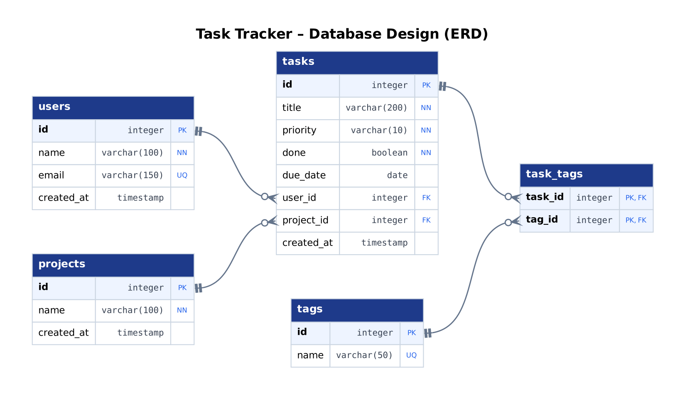

# Task Tracker Database – Answer Key

Model answer for the **Week 4 · Day 1** task: *PostgreSQL Basics and Database Design*.
All SQL was tested on PostgreSQL 16.

## Folder structure

```
database/
├── README.md
├── sql/
│   ├── 01-create-tasks.sql   Part 2: tasks table, 10 tasks, 2 failing inserts
│   ├── 02-queries.sql        Part 3: the 13 queries
│   └── 03-full-schema.sql    Bonus: the 5-table design in SQL (+ due date CHECK)
└── design/
    ├── normalization.md      Part 4: the 6 normalization answers
    ├── schema.dbml           Part 5: the design in DBML (paste into dbdiagram.io)
    └── erd.png               Part 5: the diagram
```

## How to run

1. In pgAdmin, open the **Query Tool** on the `task_tracker` database.
2. Open and run `sql/01-create-tasks.sql`. It creates the table and the 10 tasks.
3. Open `sql/02-queries.sql` and run the queries **one by one** (select a query, then press F5).
4. To see the full design, run `sql/03-full-schema.sql`. It **replaces** the `tasks` table with the 5-table version, so run file 01 again afterwards if you want the simple table back.

Every file can be run again safely; each one drops its tables first.

## How the data meets the rules (Part 2)

| Rule | Tasks |
|---|---|
| At least 3 high, 3 medium, 2 low | 3 high, 5 medium, 2 low |
| At least 3 done | Tasks 1, 4, 7 |
| At least 2 with "React" | Tasks 3, 4 |
| At least 2 with no due date | Tasks 3, 7, 10 |
| One inserted with only a title | Task 10 (gets `medium`, `false`, no due date) |

## The design (Part 5)



| Relationship | Type | How |
|---|---|---|
| users → tasks | One user has many tasks | `tasks.user_id` → `users.id` |
| projects → tasks | One project has many tasks | `tasks.project_id` → `projects.id` |
| tasks ↔ tags | Many-to-many | Linking table `task_tags` (`task_id`, `tag_id`) |

**Diagram key:** PK = primary key, FK = foreign key, NN = not null, UQ = unique.
On the lines, the two bars mean **one**, and the circle with three prongs ("crow's foot") means **many (or none)**.

## Expected commits

```
chore: set up project structure
feat: create tasks table and seed data
feat: add task queries
docs: add normalization answers
docs: add database diagram
```

## Points to check when marking

- `01` must contain `CREATE TABLE` **with `due_date`**, not only inserts.
- Query 7 uses `IS NULL`; `= NULL` returns nothing.
- Query 8 must skip tasks with no due date, or they can appear in the result.
- Query 13 has a `SELECT` with the same `WHERE` **before** the `DELETE`.
- `task_tags` has a **composite primary key** (`task_id`, `tag_id`) and two foreign keys.
- The normalization answers name **1NF** for `tags` and **3NF** for `user_name` / `user_email`.
